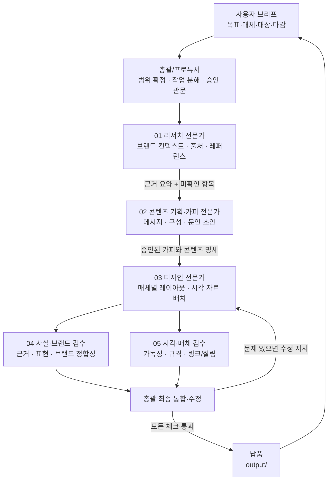

# 꾸미스튜디오 업무팀 에이전트 구성 계획

- 작성일: 2026-10-04
- 목적: 리서치 → 콘텐츠 기획/작성 → 디자인 → 검수 → 납품 흐름을 Claude Code의 공식 에이전트 운용 방식에 맞춰 제안
- 적용 범위: 카드뉴스, YouTube 썸네일, 포트폴리오/PPT, 브랜드·로컬 콘텐츠

> **권고 요약:** 총괄 1개 세션이 프로젝트 컨텍스트와 최종 파일을 관리하고, 반복 가능한 전문 작업에 프로젝트 서브에이전트를 사용합니다. 실제 Agent Teams는 기본 도구로 상시 활성화하지 않습니다. 조사·최종 검수처럼 서로 독립적인 일이 동시에 필요할 때만 실험적 Agent Teams를 선택적으로 검토합니다.

## 1. 팀 계획도



단계 간 산출물은 다음 작업의 입력으로 사용합니다. 검수는 독립적으로 확인할 수 있는 사실·표현과 시각·규격 항목을 나눠 병렬화하되, 수정 결정과 최종 승인권은 총괄에 둡니다.

## 2. 역할 및 책임

| 역할 | 주요 책임 | 입력 | 출력 | 권한/경계 |
|---|---|---|---|---|
| **총괄 / Producer (주 세션)** | 브리프 확인, 작업 순서·의존성 설정, 사용자 승인 요청, 의견 통합, 납품 파일 확정 | 사용자 요청, `CLAUDE.md`, `output/project-context.md` | 승인된 작업 명세, 통합본, 납품 요약 | 최종 판단과 파일 소유자. 사용자가 확인하지 않은 범위·성과를 확정하지 않음 |
| **01 리서치 전문가** | 공식 자료와 프로젝트 폴더를 확인하고 사실·해석·미확인 사항 분리 | 요청, 브랜드 컨텍스트, 관련 템플릿, 공개 출처 | 간결한 근거 표, 인용 링크, 핵심 메시지 후보, 확인 질문 | 읽기 전용. 원본/산출물을 직접 수정하지 않음 |
| **02 콘텐츠 기획·카피 전문가** | 타깃·목표에 맞게 스토리 흐름과 메시지·문구 작성 | 총괄 승인 브리프, 리서치 결과, 해당 매체 템플릿 | 콘텐츠 아웃라인, 카드/슬라이드별 문안, CTA 초안 | 사실은 근거에 맞춤. 숫자·고객 성과·기능을 임의로 만들지 않음 |
| **03 디자인 전문가** | 승인된 문안을 템플릿의 정보 위계·규격에 적용하고 이미지 명세 구성 | 승인 카피, 레퍼런스, 매체 규격 | 디자인 명세/레이아웃, 편집 가능한 납품물 또는 이미지 배치 지시 | `context/`, `template/` 보존. 최종 산출은 `output/`에 저장 |
| **04 사실·브랜드 검수** | 문안과 결과물이 공개 자료 및 브랜드 컨텍스트와 맞는지 검토 | 리서치 근거, 카피, 디자인 결과 | 문제 목록(심각도·위치·근거) 및 통과/수정 의견 | 읽기 전용. 원문을 직접 덮어쓰지 않고 수정 제안을 반환 |
| **05 시각·매체 검수** | 모바일/발표 크기 가독성, 비율, 잘림, 정렬, 링크/QR, 파일 완성도 확인 | 결과물과 매체별 체크리스트 | 검수표 및 수정 권고 | 읽기 전용. 최종 승인 대신 객관적 검사 결과만 제출 |

역할은 필요할 때마다 모두 띄우지 않습니다. 작은 단일 산출물은 총괄이 직접 처리하고, 조사량이 많거나 독립적인 평가가 필요한 작업에만 전문가를 호출합니다.

## 3. 권장 진행 순서와 승인 관문

### 0단계 — 브리프 정리 (총괄)

작업 시작 전 다음을 확인합니다.

- 콘텐츠/디자인 목표와 성공 조건
- 주요 독자·고객과 배포 채널
- 산출물 종류, 수량, 비율, 파일 형식, 마감
- 제공된 원고·브랜드 자료·이미지와 사용 권한
- 사실 검증이 필요한 문구·수치·일정

요청이 명확하면 불필요한 질문은 줄이고, 디자인 방향 또는 표현 범위가 결과에 크게 영향을 줄 때 사용자 승인을 받습니다.

### 1단계 — 리서치 (01)

- `context/`와 관련된 `template/` 문서를 먼저 확인합니다.
- 외부 사실은 공식 사이트, 공식 문서, 원출처를 우선합니다.
- 결과를 `확인된 사실 / 해석·제안 / 확인 필요`로 나눕니다.
- 콘텐츠 제작자에게 전달할 핵심 근거와 금지/주의 문구를 요약합니다.

**관문 R:** 총괄이 핵심 사실과 미확인 항목을 확인합니다. 브랜드 표현이나 공개 사실에 중요한 공백이 있으면 카피 작성 전에 사용자 확인을 요청합니다.

### 2단계 — 콘텐츠 전략·카피 (02)

- 채널과 목표에 맞는 메시지 한 가지를 정합니다.
- 카드뉴스는 후킹 → 문제/맥락 → 핵심 정보 → 예시 → CTA, PPT는 소개 → 서비스 → 사례 → 과정 → 문의 등 매체 템플릿의 흐름을 사용합니다.
- 출처가 필요한 주장에는 근거를 연결하고, 모르는 정보는 `[확인 필요]`로 남깁니다.
- 디자인이 문구를 다시 해석하지 않도록 카피와 이미지 의도를 함께 전달합니다.

**관문 C:** 총괄 또는 사용자가 메시지·사실·톤을 승인한 뒤 디자인에 넘깁니다.

### 3단계 — 디자인·제작 (03)

- 해당 채널의 템플릿과 실제 레퍼런스를 비교해 구조를 선택합니다.
- 매체별 크기와 안전 여백, 이미지 비율을 적용합니다.
- 원본 이미지·로고·인물의 권리 상태를 점검하고 사용 출처를 기록합니다.
- 파일명은 알아보기 쉽게 작성하고 최종 결과물을 `output/`에 저장합니다.

**관문 D:** 총괄이 의도·카피·파일 유형을 확인해 검수용 버전을 고정합니다.

### 4단계 — 독립 검수 병렬 실행 (04 + 05)

- **사실·브랜드 검수:** 문구의 근거, 과장 여부, 용어 일관성, 로고·브랜드 맥락을 점검합니다.
- **시각·매체 검수:** 작은 화면/발표 화면에서의 가독성, 비율, 잘림, 정렬, 링크·QR, 납품 파일을 점검합니다.
- 두 검수자는 파일을 직접 수정하지 않고, 위치가 분명한 문제와 권고를 총괄에게 반환합니다.

**관문 Q:** 총괄이 두 결과를 통합해 중요도 순으로 수정하고, 필요한 경우 해당 전문가에게 재검수를 요청합니다.

### 5단계 — 납품 (총괄)

- 최종 파일을 `output/`에 정리합니다.
- 원본/편집 파일과 미리보기 파일이 있다면 이름과 버전을 구분합니다.
- 사용자에게 파일 링크, 형식, 핵심 완료 사항, 남은 확인 사항을 보고합니다.

## 4. Claude Code 공식 기능에 맞춘 운영 방식

### 기본값: 단일 총괄 세션 + 필요한 서브에이전트

이 프로젝트의 작업은 리서치 → 카피 → 디자인처럼 앞 단계의 결과가 다음 단계에 필요한 순차 의존성이 큽니다. Claude Code 공식 문서는 이런 순차 작업에는 Agent Teams보다 단일 세션 또는 서브에이전트가 효과적이라고 안내합니다. 따라서:

- 총괄 세션이 계획·승인·통합을 관리합니다.
- 서브에이전트는 조사 결과나 검토 의견처럼 **위임해도 되는 독립 단위**를 수행하고 요약을 반환합니다.
- `.claude/agents/`에는 재사용할 역할 정의 파일을 저장합니다. 파일을 만든 것만으로 실행 중인 서브에이전트가 생기는 것은 아닙니다.
- Claude Code 총괄 세션이 정의를 발견한 뒤 작업을 위임할 때, 그 작업을 수행할 런타임 서브에이전트가 생성됩니다. 작업이 끝나면 결과를 총괄에 반환하며, 계속 살아 있는 상시 작업자가 아닙니다.
- 서브에이전트의 `tools`는 업무에 필요한 최소 권한으로 제한하고, 리서치·검수 역할은 읽기 전용을 우선합니다.

### 선택 사항: 실험적 Agent Teams

Agent Teams를 쓰는 편이 나은 경우:

- 두 명 이상의 조사자가 서로 다른 출처/주제를 독립적으로 조사하고 결과를 교차 검증해야 하는 경우
- 최종 결과물의 사실 검수와 시각/접근성 검수를 동시에 수행할 때
- 역할 간 의견 교환이나 공유 작업 목록이 실제로 필요한 복합 캠페인

사용을 피하거나 최소화할 경우:

- 한 장짜리 카드뉴스나 단일 썸네일처럼 작은 산출물
- 동일 파일을 여러 에이전트가 동시에 고쳐야 하는 작업
- 앞 단계 승인 전 다음 단계가 시작될 수 없는 높은 의존성 작업
- 결과 취합 이득보다 세션·토큰·조정 비용이 더 큰 경우

공식 문서 기준 Agent Teams는 **실험 기능이며 기본 비활성화**입니다. 사용하려면 Claude Code 설정 또는 환경에서 `CLAUDE_CODE_EXPERIMENTAL_AGENT_TEAMS=1`을 명시해야 합니다. 이 문서는 운영 계획 제안이며, 팀 기능이나 설정을 활성화하지 않았습니다. 활성화 전 제한 사항과 비용을 사용자가 검토하도록 합니다.

## 5. 작업 단위와 의존성 예시

### 역할 정의 파일과 실제 실행 인스턴스 구분

아래 파일들은 Claude Code 공식 프로젝트 서브에이전트 형식(YAML frontmatter + Markdown 지침)의 **역할 정의**입니다. 이들은 재사용 가능한 설정이지, 실행 중인 에이전트 인스턴스가 아닙니다.

| 구분 | 무엇인지 | 이 프로젝트의 현재 상태 |
|---|---|---|
| 역할 정의 (agent definition) | 에이전트 이름·설명·도구 권한·업무 지침을 담은 파일 | 아래 다섯 개가 `.claude/agents/`에 존재 |
| 실행 인스턴스 (runtime subagent) | Claude Code 총괄이 특정 작업을 위임할 때 실행되는 별도 작업자 | 이 문서를 갱신하는 현재 Copilot 세션에서는 생성되어 있지 않음 |
| Agent Teams | 여러 Claude Code 세션이 협업하는 별도 실험 기능 | 활성화하지 않음 |

**따라서 현재 상태는 “정의 파일 5개, 실행 중인 Claude Code 서브에이전트 0개”입니다.** 정의를 저장하는 것과 에이전트 실행은 별도 단계입니다. 실제 실행은 Claude Code에서 프로젝트 정의를 불러온 총괄 세션이 해당 역할에 구체적인 작업을 위임할 때 발생합니다. 새 정의가 보이지 않으면 Claude Code에서 프로젝트를 다시 열거나 새 세션을 시작해 확인합니다.

| 에이전트 | 정의 파일 | 허용 도구 | 역할 |
|---|---|---|---|
| `researcher` | [`.claude/agents/researcher.md`](../.claude/agents/researcher.md) | Read, Grep, Glob, WebSearch, WebFetch | 근거·출처·미확인 정보 조사 |
| `content-planner` | [`.claude/agents/content-planner.md`](../.claude/agents/content-planner.md) | Read, Grep, Glob | 콘텐츠 구조 및 한국어 카피 초안 |
| `visual-designer` | [`.claude/agents/visual-designer.md`](../.claude/agents/visual-designer.md) | Read, Grep, Glob | 레이아웃·시각 위계·에셋 배치 명세 |
| `fact-checker` | [`.claude/agents/fact-checker.md`](../.claude/agents/fact-checker.md) | Read, Grep, Glob, WebSearch, WebFetch | 사실·인용·브랜드 표현 독립 검수 |
| `visual-qa` | [`.claude/agents/visual-qa.md`](../.claude/agents/visual-qa.md) | Read, Grep, Glob | 매체 규격·가독성·크롭·시각 품질 검수 |

총괄의 라우팅 규칙은 프로젝트 루트 [`CLAUDE.md`](../CLAUDE.md)에 있습니다. `CLAUDE.md`는 업무 지침이며 `.claude/agents/` 파일은 Claude Code가 실행 시 사용할 수 있는 역할 정의입니다. 정의 파일 자체가 실행 중인 에이전트를 의미하지는 않습니다.

| 작업 ID | 담당 | 의존성 | 완료 조건 |
|---|---|---|---|
| `brief` | 총괄 | 없음 | 목적·매체·대상·규격·사용 자료가 정리됨 |
| `research` | 리서치 전문가 | `brief` | 근거 링크와 사실/해석/확인 필요 구분 완료 |
| `copy` | 콘텐츠 전문가 | `research` | 페이지/카드별 문안과 출처가 준비되고 총괄 승인됨 |
| `design` | 디자인 전문가 | `copy` 승인 | 요청 규격의 결과물과 편집/참고 파일이 `output/`에 저장됨 |
| `fact-review` | 사실·브랜드 검수 | `design` | 미근거 주장·브랜드 불일치 항목 보고 |
| `visual-review` | 시각·매체 검수 | `design` | 가독성·규격·잘림·링크 검사 완료 |
| `delivery` | 총괄 | 두 검수 완료 | 수정 반영, 최종 파일·요약 정리 및 납품 |

`fact-review`와 `visual-review`는 디자인이 끝난 뒤 병렬로 진행할 수 있습니다. 수정/납품은 검수 결과가 모인 다음 총괄이 수행합니다.

## 6. 파일·안전 운영 원칙

- 시작 시 프로젝트 `CLAUDE.md`와 `output/project-context.md`를 먼저 읽습니다.
- 현재 프로젝트 훅 정책에 따라 일반 산출물은 `output/`에 저장합니다.
- `context/`와 `template/`은 원본 참고자료로 보존하고 직접 수정하지 않습니다.
- `.claude/` 변경은 에이전트 정의나 프로젝트 훅처럼 실제 설정이 필요하고 사용자가 승인한 경우에만 합니다.
- 리서치/검수 역할은 읽기 중심으로, 디자인 역할은 필요한 산출만 생성하도록 책임을 분리합니다.
- Claude Code의 프로젝트 에이전트 파일은 프로젝트 범위의 `.claude/agents/`에 Markdown과 YAML frontmatter로 정의합니다. 이 프로젝트 에이전트는 역할별 최소 도구 권한으로 구성했으며, 총괄이 업무에 따라 선택적으로 라우팅합니다.
- 훅은 Claude Code 도구 호출 가드레일이지 OS 샌드박스가 아니므로, 중요한 원본은 백업과 사용자 승인을 병행합니다.

## 7. 바로 사용할 수 있는 실행 프롬프트 예시

```text
이번 작업을 팀 계획에 따라 진행해줘.
1) 먼저 브리프의 산출물·채널·대상·규격을 정리하고, 모호한 핵심 결정만 확인해.
2) 리서치 역할은 관련 context/template과 신뢰할 출처를 확인해 사실·해석·확인 필요로 보고해.
3) 콘텐츠 역할은 승인된 근거만 사용해 매체별 구조와 문안을 작성해.
4) 내 승인 후 디자인 결과를 output/에 제작해.
5) 사실·브랜드 검수와 시각·매체 검수를 독립적으로 수행하고, 수정 후 최종본을 납품해.
원본 context/ 및 template/ 파일은 변경하지 말고, 근거 없는 수치·성과·고객 정보는 만들지 마.
```

## 8. 공식 참고 문서

- [Claude Code: Orchestrate teams of Claude Code sessions (Agent Teams)](https://code.claude.com/docs/en/agent-teams) — 실험적 Agent Teams의 적용 상황, 한계, 서브에이전트와의 비교, 활성화 방법
- [Claude Code: Create and use custom subagents](https://code.claude.com/docs/en/sub-agents) — 프로젝트 범위 에이전트, 역할/도구 제한, 에이전트 정의 방식
- [Claude Code: How Claude remembers your project](https://code.claude.com/docs/en/memory) — `CLAUDE.md`의 역할, 적용 범위 및 지침의 강제성 한계
